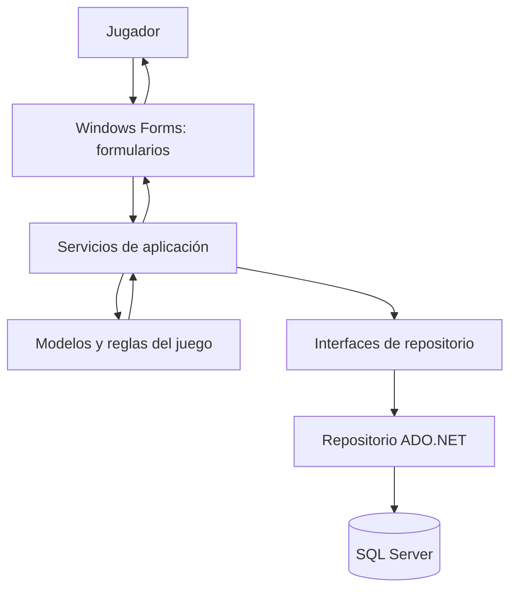

# Arquitectura propuesta para NEXUS

## 1. Objetivo

Evolucionar la aplicación de consola de H3 a una aplicación de escritorio en C# con Windows Forms y SQL Server, separando la presentación, las reglas del juego y la persistencia. La separación permitirá modificar las pantallas sin duplicar reglas y cambiar el acceso a datos sin reescribir la interfaz.

Esta arquitectura es una propuesta. Las capas y clases que se describen aquí deberán crearse durante las siguientes etapas; no se afirma que ya existan en el repositorio.

## 2. Capas

### Presentación: Windows Forms
Formularios propuestos:
- `FrmMenuPrincipal`: menú, perfil activo y acceso a módulos.
- `FrmExploracion`: mapa, movimiento, recursos, anomalías y estado.
- `FrmMisiones`: lista, objetivo y progreso.
- `FrmCadetesInventario`: datos del cadete y recursos.
- `FrmConfiguracion`: preferencias y conexión a datos, si se necesita.

Los formularios recogerán las acciones del usuario y mostrarán resultados. No deberían contener reglas de consumo de energía ni consultas SQL directamente.

### Lógica de aplicación y juego
Clases propuestas:
- `Cadete`: conservar y ajustar el modelo que actualmente existe.
- `SistemaNexus`: conservar la relación entre cadete principal y respaldo si sigue siendo necesaria.
- `Mapa` y `CasillaMapa`: representar dimensiones, terreno, base, recurso y anomalía.
- `Mision`: identificador, título, descripción, realidad, objetivo y estado.
- `Inventario` y `RecursoInventario`: cantidades de recursos del jugador.
- `JuegoService`: coordinar inicio de partida, selección de realidad y guardado de progreso.
- `ExploracionService`: validar movimiento, recolección y efectos de anomalías.
- `MisionService`: comprobar objetivos y actualizar el estado de misiones.

La lógica debe validar reglas incluso si la acción llega desde una pantalla distinta. Los servicios no deben depender de `MessageBox`, controles visuales ni consultas SQL directas.

### Acceso a datos
Clases e interfaces propuestas:
- `INexusRepository` o interfaces específicas por entidad para definir las operaciones necesarias.
- `NexusRepositorySqlServer`: implementación que usa ADO.NET para ejecutar consultas parametrizadas.
- `DatabaseConnectionFactory` o una configuración centralizada para crear conexiones sin repetir la cadena de conexión.

El acceso a datos se encargará de guardar y recuperar cadetes, partidas, misiones e inventario. Los comandos SQL deben usar parámetros; no se deben concatenar entradas del usuario en las consultas.

## 3. Diagrama de arquitectura



El diagrama también está disponible en [evidencias/diagramas.md](evidencias/diagramas.md).

## 4. Flujo de una acción

Ejemplo: recoger un recurso en el mapa.

1. El jugador selecciona una casilla en `FrmExploracion`.
2. El formulario envía la acción a `ExploracionService`.
3. El servicio verifica límites del mapa, tipo de terreno, recurso disponible y energía.
4. Si el movimiento es válido, actualiza el estado del mapa, el cadete y el inventario.
5. `MisionService` comprueba si se alcanzó el objetivo de la misión.
6. El servicio devuelve un resultado entendible para la interfaz.
7. La interfaz actualiza el mapa, los indicadores y el mensaje.
8. Si corresponde guardar el progreso, el repositorio ADO.NET persiste los cambios en SQL Server.

## 5. Relación con el código H3

| Elemento existente | Evolución propuesta |
|---|---|
| Clase `Cadete` en `Program.cs` | Mantenerla como modelo, validar sus propiedades y eliminar dependencias de consola. |
| Clase `SistemaNexus` | Conservar la relación de cadete principal y respaldo; revisar si debe convertirse en un servicio o mantener su función de modelo/agrupación. |
| Clase `Nexus` y método `Main()` | Dejar el punto de entrada para iniciar la aplicación Windows Forms; trasladar el menú y las operaciones a formularios y servicios. |
| Variables `energía` y `estabilidad` locales | Usar el estado del objeto de juego como fuente única para evitar desincronización. |
| Matrices `int[,]` de mapas | Encapsularlas en `Mapa` y representar los tipos de casilla con un tipo claro, por ejemplo un `enum`. |
| `switch` de ocho opciones | Reemplazar las opciones de consola por botones y navegación gráfica que llamen a servicios. |
| `TcpListener` y `TcpClient` | Mantenerlo fuera del alcance prioritario; no presentarlo como multijugador completo. |

## 6. Organización de proyecto recomendada

La documentación obligatoria se guardará en `docs/`. Para el código, se propone evolucionar gradualmente a una organización semejante a esta, sin mover ni renombrar archivos hasta confirmar el proyecto y compilarlo:

```text
NEXUS/
├── NEXUS/
│   └── Nexus/
│       └── Nexus/
│           ├── Nexus.csproj
│           ├── Program.cs
│           ├── Forms/
│           ├── Models/
│           ├── Services/
│           ├── Data/
│           └── Repositories/
├── docs/
└── README.md
```

La estructura interna propuesta no es una exigencia para la entrega documental actual. El requisito inmediato es mantener el código actual funcional y organizar los documentos en `docs/`.

## 7. Manejo de errores y seguridad

- Validar valores de entrada y límites del mapa en la lógica, no solo en los controles.
- Capturar errores de base de datos en la capa de acceso a datos y devolver mensajes claros.
- Usar consultas parametrizadas de ADO.NET.
- No subir contraseñas ni cadenas de conexión con credenciales al repositorio.
- Mantener la cadena de conexión en configuración local segura y documentar cómo configurarla sin publicar secretos.
- Evitar que un error al guardar cierre inesperadamente la partida; indicar si el progreso quedó sin guardar.

## 8. Plan de implementación gradual

1. Corregir y centralizar la lógica de energía, estabilidad y movimiento.
2. Crear modelos para mapa, casillas, misión e inventario.
3. Crear servicios y probar reglas sin interfaz gráfica.
4. Crear Windows Forms y conectar botones a los servicios.
5. Diseñar la base de datos y repositorios ADO.NET.
6. Añadir guardado y recuperación de partidas.
7. Probar flujos normales, datos inválidos, errores de conexión y recuperación de progreso.
8. Dejar red cooperativa y efectos avanzados para una fase posterior.
