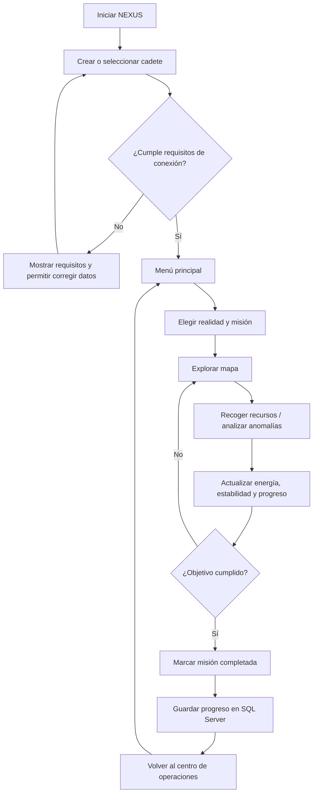
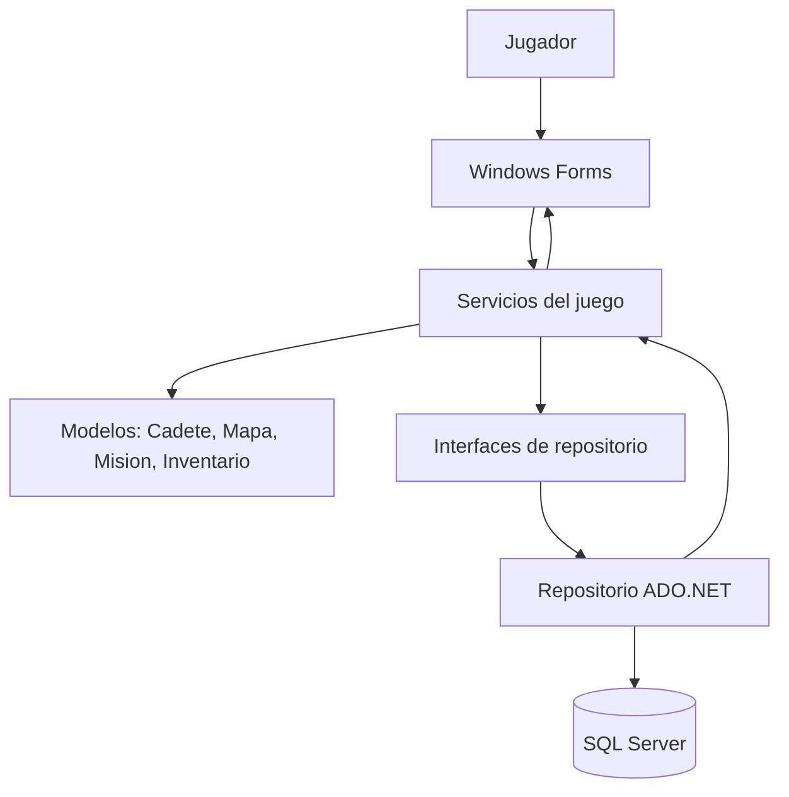
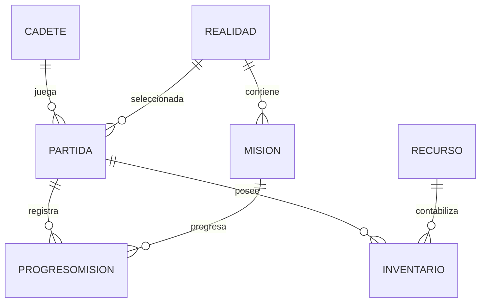

# Evidencias de diseño y diagramas

Este archivo reúne diagramas textuales versionables para la propuesta. Los cuatro wireframes principales están en [../diseno-del-juego.md](../diseno-del-juego.md). Si se elaboran dibujos o capturas con una herramienta gráfica, deben guardarse en esta carpeta y enlazarse desde el documento de diseño.

## 1. Ciclo principal del juego

Nota: el guardado en SQL Server y el catálogo general de misiones pertenecen a la versión propuesta, no a la versión de consola H3.

## 2. Arquitectura propuesta

## 3. Modelo de datos

## 4. Evidencias gráficas que se pueden añadir

Cuando se elaboren en una herramienta de dibujo o diseño, guardar aquí archivos con nombres claros, por ejemplo:
- `wireframe-menu-principal.png`
- `wireframe-exploracion.png`
- `wireframe-misiones.png`
- `wireframe-cadetes-inventario.png`

Los bocetos incluidos en `diseno-del-juego.md` ya sirven como wireframes iniciales. Las imágenes son una mejora visual opcional, salvo que el docente solicite expresamente dibujos gráficos.
