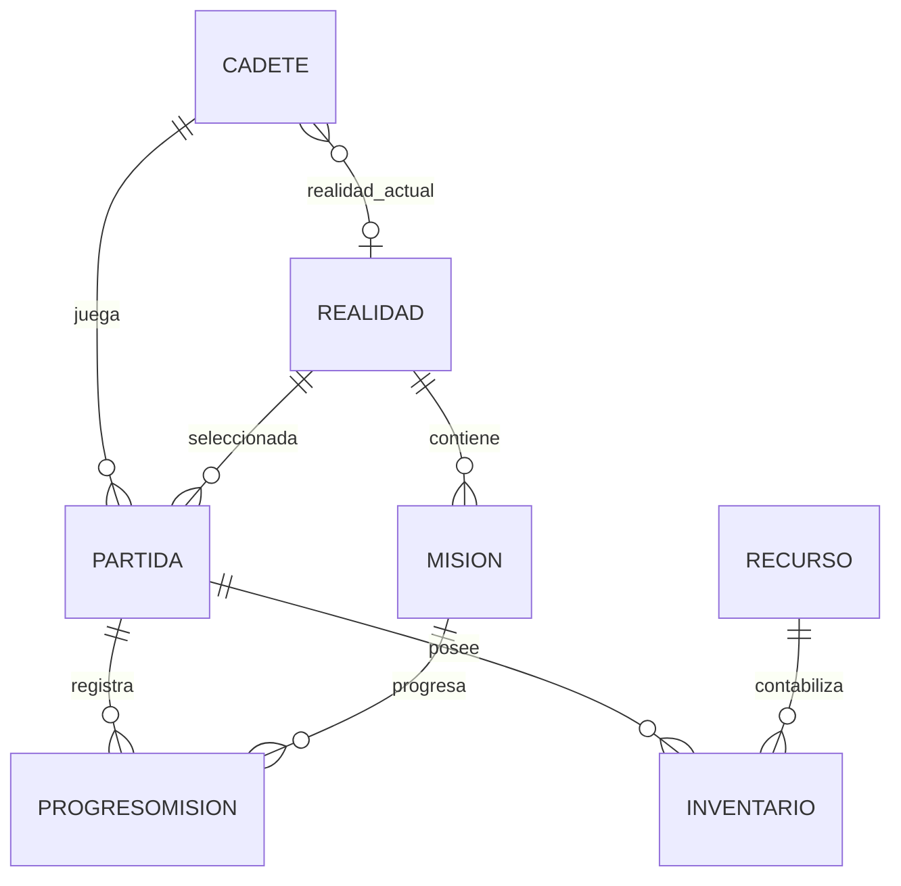

# Modelo de datos propuesto para NEXUS

## 1. Propósito y estado

Este modelo define cómo podría guardarse el progreso de NEXUS en SQL Server. Es una propuesta para la siguiente etapa; el código H3 actual no contiene tablas, conexión SQL ni persistencia.

El objetivo es conservar el cadete, la realidad seleccionada, las misiones realizadas y los recursos entre sesiones, evitando guardar todo únicamente en variables de memoria.

## 2. Entidades propuestas

### Cadete
Representa el perfil del explorador.
- `CadeteId`: clave primaria.
- `Nombre`: nombre mostrado.
- `Edad`: edad validada.
- `Energia`: valor de 0 a 100.
- `Estabilidad`: valor de 0 a 100.
- `RealidadActualId`: clave foránea a Realidad, si se registra una realidad actual.

Se relaciona con Partida y puede tener un inventario asociado.

### Realidad
Catálogo de realidades disponibles.
- `RealidadId`: clave primaria.
- `Codigo`: IRIS-07, IRIS-12 o IRIS-21; valor único.
- `Nombre`: Valle de Cristal, Sector Abisal o Zona de Interferencia.
- `Descripcion`: explicación del lugar.
- `Disponible`: indica si se puede seleccionar.

### Partida
Representa una sesión de juego que puede continuar más adelante.
- `PartidaId`: clave primaria.
- `CadeteId`: clave foránea a Cadete.
- `FechaCreacion`: fecha de creación.
- `FechaActualizacion`: último guardado.
- `Estado`: activa, pausada o finalizada.
- `RealidadActualId`: realidad seleccionada.
- `FilaJugador` y `ColumnaJugador`: posición en el mapa.

### Mision
Catálogo de objetivos disponibles.
- `MisionId`: clave primaria.
- `RealidadId`: clave foránea a Realidad.
- `Titulo`: nombre de la misión.
- `Descripcion`: instrucciones.
- `TipoObjetivo`: por ejemplo, recolectar recursos.
- `CantidadObjetivo`: cantidad necesaria.
- `Recompensa`: campo opcional para una futura regla de recompensa.

El objetivo actual de recoger tres recursos puede convertirse en una misión inicial de este catálogo.

### ProgresoMision
Registra el avance de una partida en cada misión.
- `ProgresoMisionId`: clave primaria.
- `PartidaId`: clave foránea a Partida.
- `MisionId`: clave foránea a Mision.
- `CantidadActual`: avance actual.
- `Estado`: disponible, en curso o completada.
- `FechaCompletada`: fecha opcional.

Debe existir una restricción única para la combinación `PartidaId + MisionId`, para evitar duplicar el progreso de la misma misión en una partida.

### Recurso
Catálogo de recursos.
- `RecursoId`: clave primaria.
- `Nombre`: nombre del recurso.
- `Descripcion`: explicación.
- `Tipo`: clasificación.

### Inventario
Cantidad de cada recurso que posee una partida.
- `InventarioId`: clave primaria.
- `PartidaId`: clave foránea a Partida.
- `RecursoId`: clave foránea a Recurso.
- `Cantidad`: entero no negativo.

Debe existir una restricción única para `PartidaId + RecursoId`, para mantener una sola fila por recurso en cada partida.

## 3. Relaciones

- Una realidad puede estar asociada a muchas misiones.
- Un cadete puede tener muchas partidas.
- Una partida pertenece a un cadete y guarda una realidad actual.
- Una partida puede registrar progreso en muchas misiones; una misión puede aparecer en muchas partidas. La tabla ProgresoMision resuelve esa relación de muchos a muchos.
- Una partida tiene varias filas de inventario; cada fila referencia un tipo de recurso.
- Un recurso puede estar presente en muchos inventarios.

## 4. Diagrama entidad-relación

La versión legible del diagrama está también en [evidencias/diagramas.md](evidencias/diagramas.md).

## 5. Reglas de integridad recomendadas

- Claves primarias para identificar cada registro.
- Claves foráneas para evitar referencias a cadetes, partidas, realidades o recursos inexistentes.
- `CHECK (Energia BETWEEN 0 AND 100)` y `CHECK (Estabilidad BETWEEN 0 AND 100)`.
- `CHECK (Cantidad >= 0)` para inventario y progreso.
- `UNIQUE` para el código de realidad y para las combinaciones de progreso e inventario indicadas anteriormente.
- Tipos de datos adecuados: `int` para identificadores y cantidades, `nvarchar` para texto y `datetime2` para fechas.
- Definir las reglas de eliminación de manera explícita; no eliminar partidas o catálogos automáticamente sin decidir antes cómo conservar el historial.

## 6. Estrategia para guardar y recuperar

1. Al crear un perfil, insertar el cadete y obtener su identificador.
2. Al comenzar una partida, insertar una fila de Partida.
3. Al cambiar de posición, recoger recursos o completar una misión, actualizar el estado en memoria.
4. Guardar los cambios relacionados en una transacción cuando varias tablas deban actualizarse juntas.
5. Al salir o pausar, guardar la posición, energía, estabilidad, realidad, inventario y progreso de misiones.
6. Al continuar, consultar la partida activa y recuperar los registros asociados.
7. Si la base de datos no está disponible, mostrar un mensaje claro y no indicar que el guardado fue exitoso.

Para un primer prototipo se puede guardar al finalizar cada acción importante y también al salir de una pantalla. El equipo debe decidir la frecuencia definitiva según las pruebas.

## 7. Acceso desde C#

Se recomienda ADO.NET para mantener la solución próxima a los contenidos de C# y SQL Server del proyecto. Las operaciones deberán usar `SqlConnection`, `SqlCommand` y parámetros; se abrirá la conexión solo durante la operación necesaria y se cerrará mediante `using`.

No se debe guardar una contraseña real en el código ni publicar una cadena de conexión con credenciales. La configuración local debe explicarse sin exponer secretos.

## 8. Alcance de la primera versión de base de datos

Priorizar:
1. Crear y consultar cadetes.
2. Crear y recuperar partidas.
3. Guardar realidad, posición, energía y estabilidad.
4. Guardar progreso de la misión de recolección.
5. Guardar y recuperar inventario.

El catálogo de recompensas, historial avanzado y sincronización en red pueden esperar. El esquema deberá revisarse al implementar las pantallas y probar el flujo real.
